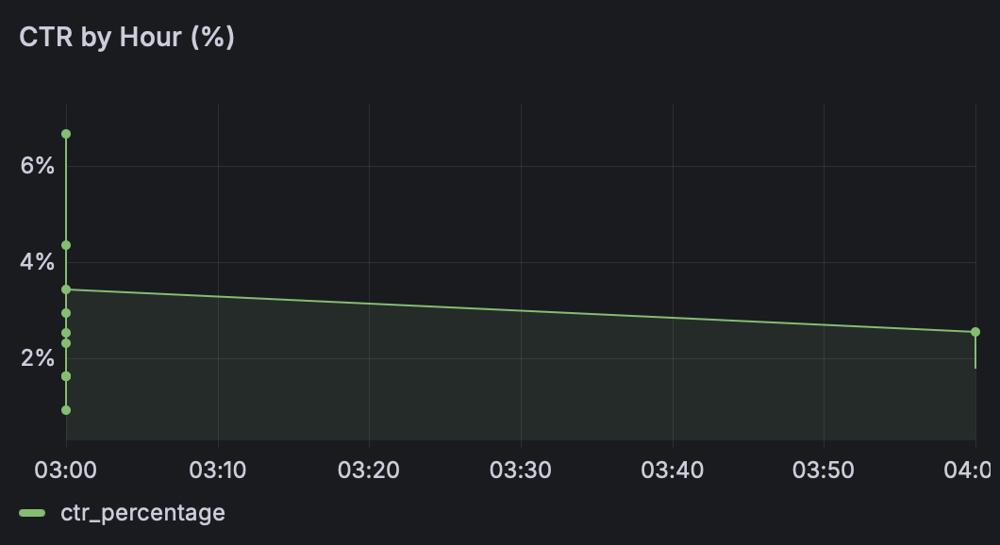
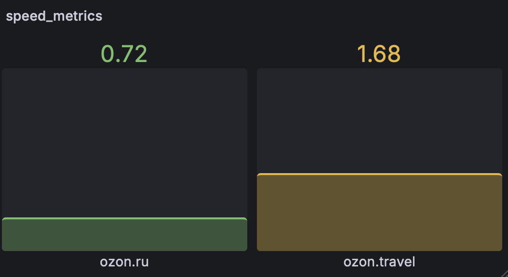
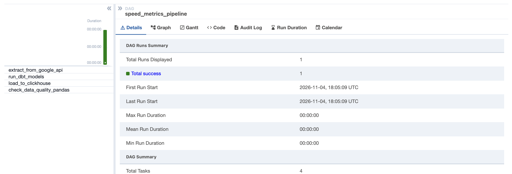
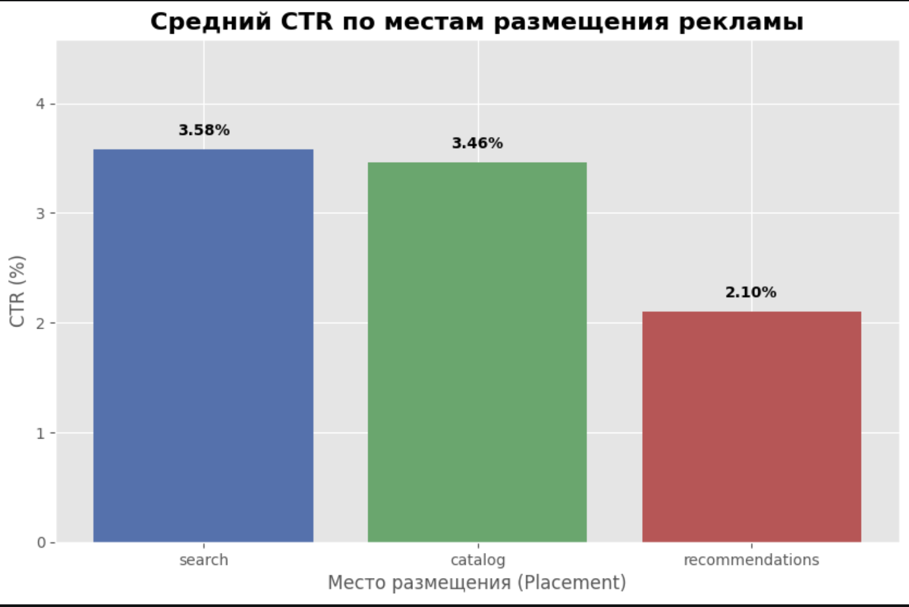
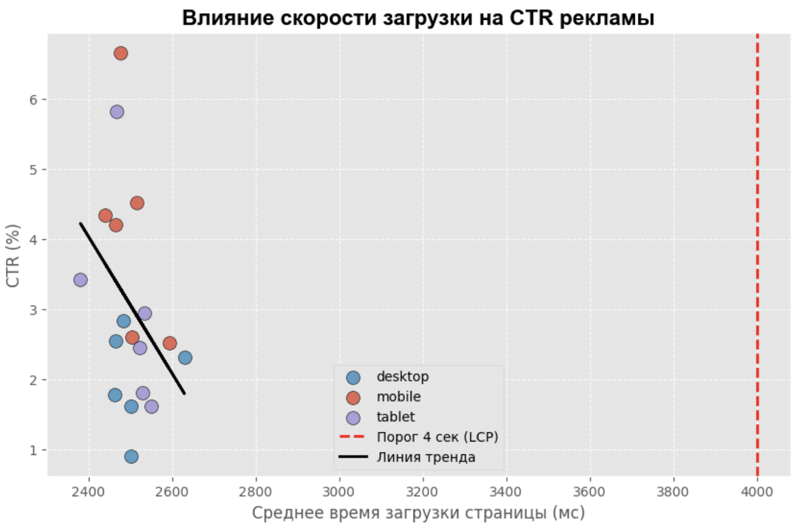

# Analytics Pipeline(Pet Project)

##  О проекте
Сквозной ETL-пайплайн для сбора, трансформации и визуализации метрик производительности сайтов . 
Проект демонстрирует навыки работы с реальными API, реляционными и колоночными базами данных, а также инструментами оркестрации (Airflow) и BI (Grafana).

##  Архитектура данных
1. **Extract (Python):** Скрипт (`extract_speed_data.py`) собирает реальные метрики скорости (LCP, CLS, TBT) для сайтов (Ozon, WB, МТС) через Google PageSpeed Insights API и сохраняет их в PostgreSQL.
2. **Transform (dbt):** Сырые данные очищаются и агрегируются в витрины с помощью dbt (модели: `stg_speed_metrics` -> `speed_metrics_daily`).
3. **Load (Python):** Готовые витрины переливаются в колоночную СУБД ClickHouse для быстрой аналитики.
4. **Orchestration (Airflow):** DAG (`speed_metrics_pipeline`) автоматически запускает весь пайплайн по расписанию (ежедневно в 18:00). но конечно держать включенным я его не буду) 
5. **Data Quality (Pandas):** Задача проверяет, что данные не пустые и нет аномалий.
6. **Visualize (Grafana):** Дашборды подключаются к ClickHouse и отображают динамику скорости загрузки с цветовыми порогами.

##  Стек технологий
* **Языки:** Python, SQL
* **Базы данных:** PostgreSQL (OLTP), ClickHouse (OLAP)
* **Инструменты:** Apache Airflow, dbt, Docker, Grafana, Jupyter Notebook
* **Библиотеки:** Pandas, NumPy, PySpark, requests, psycopg2, clickhouse-connect

##  Исследовательская часть (Ad-hoc Analysis)
В файле `research.ipynb` проведен анализ данных с помощью Pandas и Matplotlib. 
* Выявлена зависимость: при времени загрузки страницы (LCP) > 4000 мс кликабельность рекламы (CTR) падает. 
* В папке также лежат скрипты для генерации синтетических логов рекламы (`simulate_events.py`) и альтернативная реализация ETL на PySpark (`etl_to_clickhouse_pyspark.py`) для демонстрации навыков.

## ПОДБОРКА СКРИНШОТОВ! 
скришоты из графана(линейный по синтетическим данным, другой с апи)


скриншот выполненной задачи в эирфлоу


скриншоты из джупайтера 


##  Как запустить проект
1. Поднять ClickHouse и Grafana в Docker:
   ```bash
   docker run -d --name clickhouse-server -p 8123:8123 -e CLICKHOUSE_PASSWORD=my_secret_password clickhouse/clickhouse-server
   docker run -d --name grafana -p 3000:3000 -e GF_INSTALL_PLUGINS=grafana-clickhouse-datasource grafana/grafana-oss

2. Установка 
   pip install -r requirements.txt

3. Airflow DOcker (с привязкой папок) и включить DAG speed_metrics_pipeline
