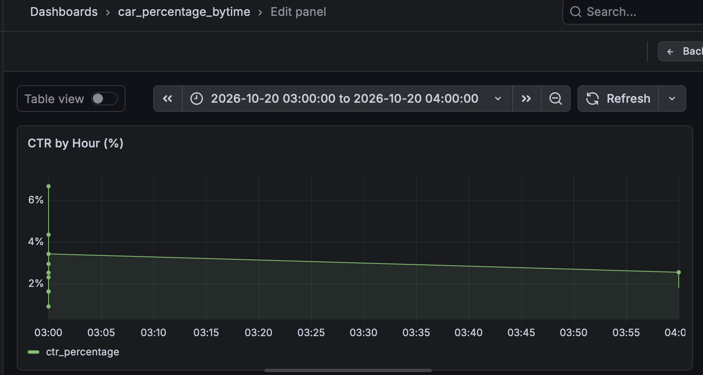
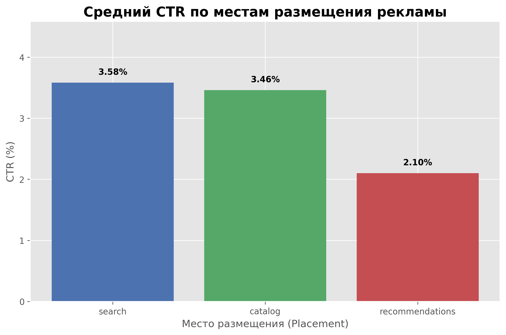

# Ads Analytics Pipeline (Pet Project)

##  О проекте
Разработка сквозного ETL-пайплайна для анализа эффективности рекламной выдачи и мониторинга скорости загрузки страниц. 
Проект демонстрирует навыки работы с реляционными и колоночными базами данных, обработки данных на Python (Pandas / PySpark) и визуализации в BI.

##  Стек технологий
* **Языки:** Python, SQL
* **Базы данных:** PostgreSQL (OLTP), ClickHouse (OLAP)
* **Обработка данных:** Pandas, PySpark (ну реализовал, вдруг будет не 5тыс а 5млн строк), NumPy
* **Инфраструктура:** Docker, Grafana
* **Инструменты:** DBeaver, Jupyter Notebook, Git

##  Архитектура пайплайна
1. **Генерация данных:** Python-скрипт (`simulate_events.py`) генерирует сырые логи показов и кликов (с учетом метрик скорости сайта) и пишет их в PostgreSQL.
2. **ETL (Extract, Transform, Load):** Скрипт (`etl_to_clickhouse.py`) забирает данные из PostgreSQL, агрегирует их с помощью Pandas, считает метрики (CTR) и загружает в ClickHouse.
3. **Визуализация:** Grafana подключается к ClickHouse и строит дашборды. Также проведен ad-hoc анализ в Jupyter Notebook с построением графиков через Matplotlib.

##  Результаты и инсайты
* Построен дашборд в Grafana, отображающий динамику CTR и среднее время загрузки страниц.
* **Главный инсайт:** Выявлена зависимость — при времени загрузки страницы (LCP) более 4000 мс, CTR рекламы имеет тенденцию к снижению. Мобильные устройства показывают более высокое время загрузки по сравнению с десктопом.

##  Как запустить проект
1. Поднять ClickHouse и Grafana в Docker:
   ```bash
   docker run -d --name clickhouse-server -p 8123:8123 -e CLICKHOUSE_PASSWORD=my_secret_password clickhouse/clickhouse-server
   docker run -d --name grafana -p 3000:3000 -e GF_INSTALL_PLUGINS=grafana-clickhouse-datasource grafana/grafana-oss

2. pip install -r requirements.txt 

3. Запустить генератор данных: python simulate_events.py
4. Запустить ETL-процесс: python etl_to_clickhouse.py
5. Открыть Grafana (localhost:3000) и настроить Data Source на ClickHouse (host.docker.internal:8123)

## Скриншот из Grafana


## Скриншот графиков MathPlotLib




